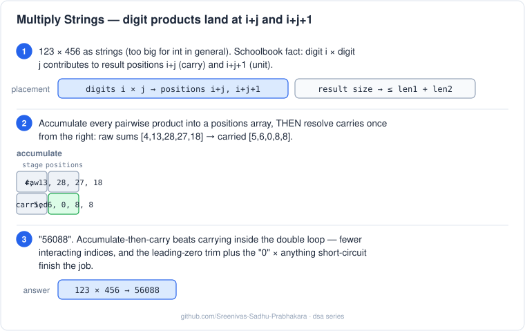

# Multiply Strings

> NeetCode 150 · Math & Geometry — grade-school multiplication with one positional fact doing the work: digit i times digit j lands at i+j+1, carrying into i+j. Go, stdlib only, tested.

## Problem

Multiply two arbitrarily large non-negative decimal numbers given as strings — big-int conversion forbidden, which is the point.

## Approach

The paper algorithm, flattened: a product of an n-digit and m-digit number fits in n+m digits, so allocate that once and let every digit pair accumulate into its two known slots — `prod + acc[i+j+1]` writes its ones-digit there and carries into `acc[i+j]`. No per-row partial strings, no alignment bookkeeping; the index arithmetic *is* the alignment. The result has at most one leading zero to strip (n+m was the upper bound), and "0" inputs short-circuit so the all-zero accumulator never needs special casing. The property test cross-checks against `math/big` over random 25-digit numbers — the gold-standard oracle sitting right in the stdlib.

**Complexity:** O(n·m) time, O(n+m) space. (Karatsuba and FFT take over asymptotically; this is the honest interview answer.)

## Visual walkthrough

Read the picture top to bottom — each numbered frame is one moment of the algorithm
running on this repo's test example.

## Run

    go test ./...   # verify
    go run .        # demo

---

Part of a 275-repo DSA series in Go — Striver's SDE Sheet (dsa-001–191) plus the NeetCode 150 / Blind 75 additions (dsa-192–275), stdlib only, every solution tested. Browse: [`dsa-*` repos](https://github.com/Sreenivas-Sadhu-Prabhakara?tab=repositories&q=dsa-&type=source).
